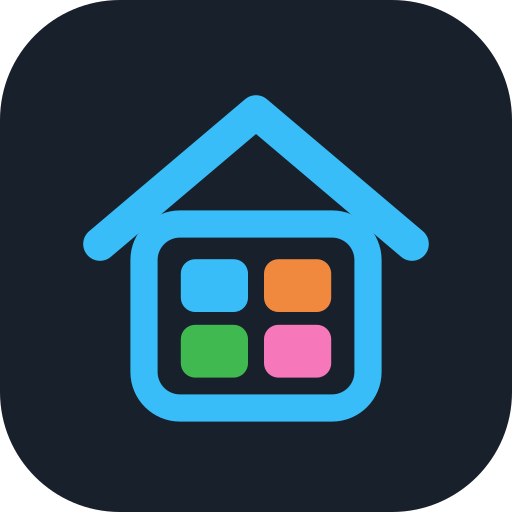
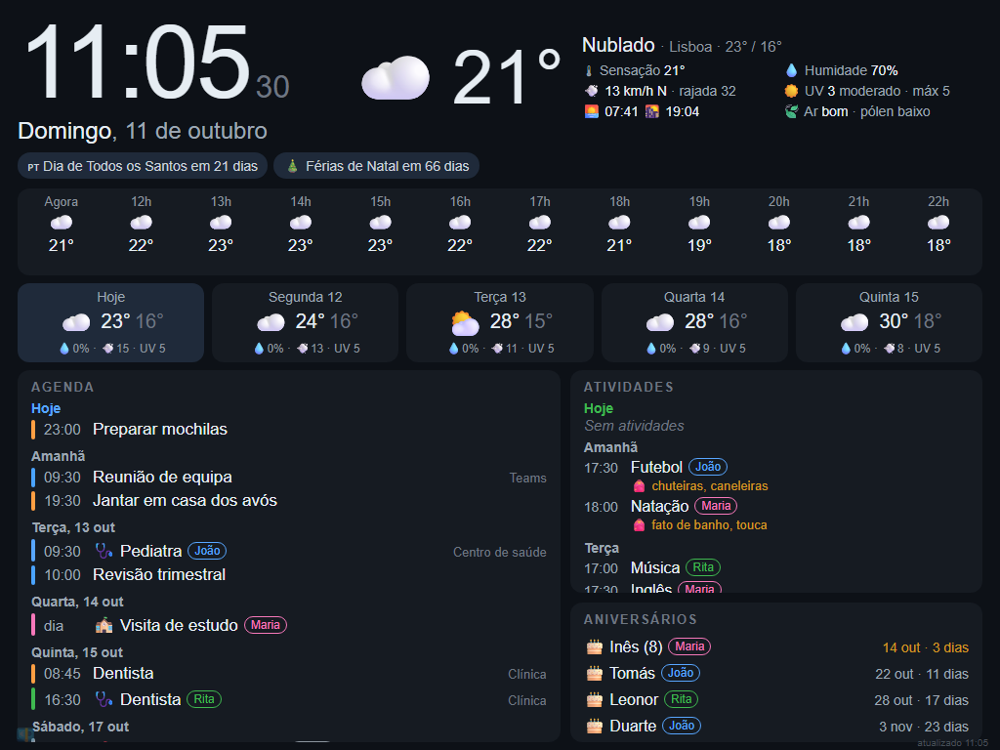
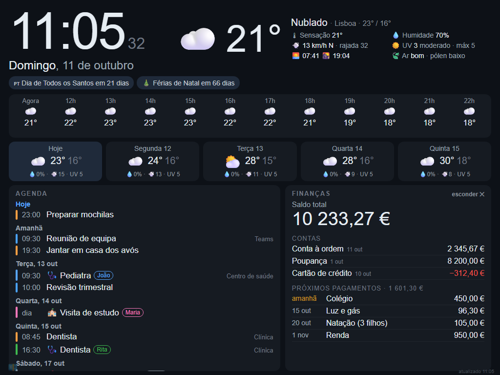
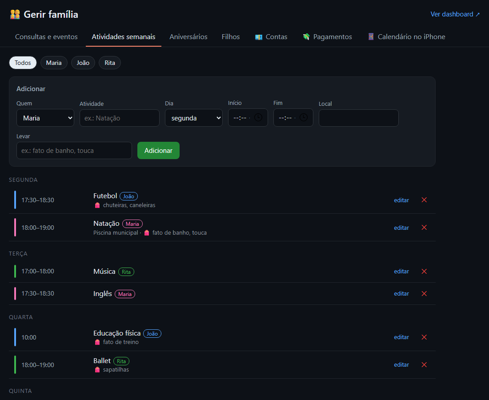
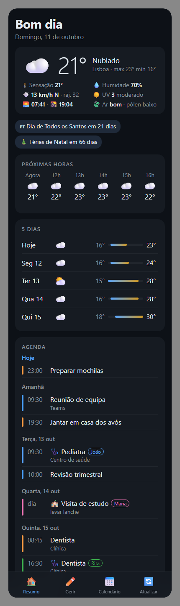
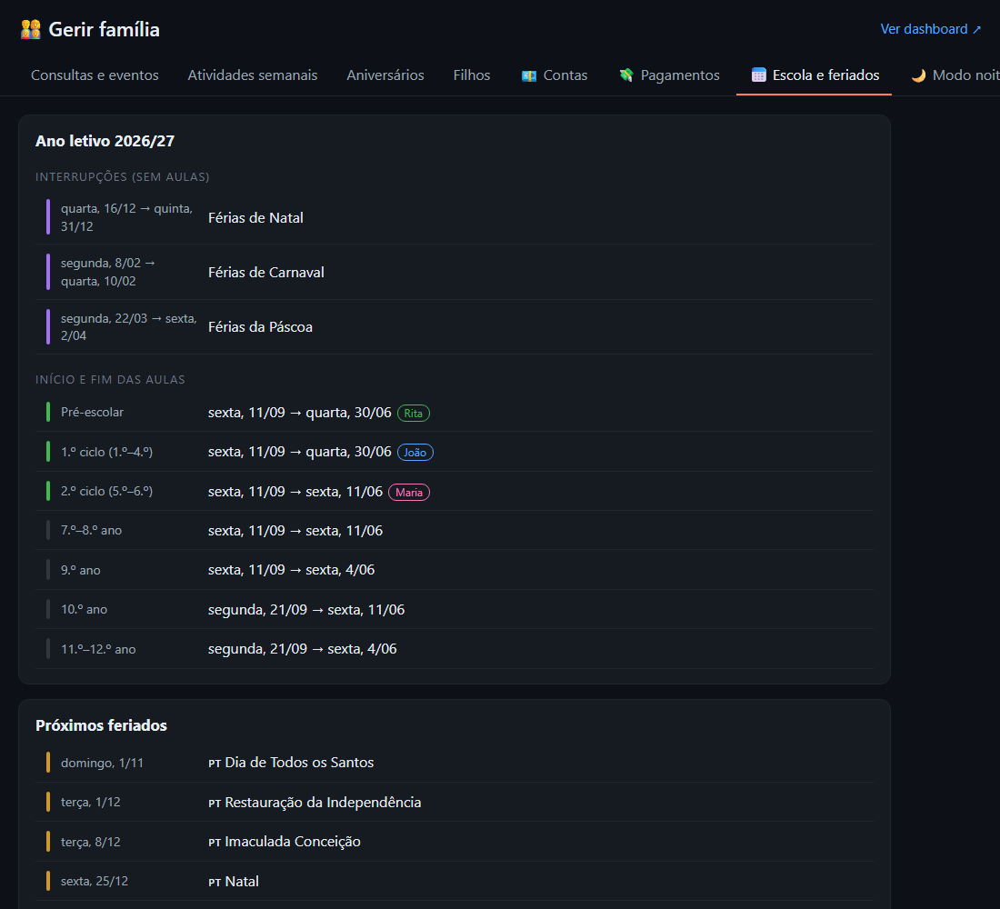

# FamilyDesk

O painel da família à porta de casa.
<br clear="left">

Dashboard para um **iPad 2** pendurado na entrada de casa. Mostra:

- relógio, data, frase do dia e o tempo agora (com nascer e pôr do sol);
- faixa com as próximas horas e os próximos 6 dias; a vista ampliada tem UV, vento e rajadas, qualidade do ar, pólen e os 7 dias em detalhe; avisos do IPMA e dicas como "levar guarda-chuva" só aparecem quando há;
- **agenda única dos próximos 30 dias**: calendários (iPhone, opcionalmente Outlook), eventos dos filhos, aniversários e prazos da casa, com scroll;
- atividades da semana de cada filho, uma linha por atividade, com os dias e o que levar; escola de hoje e amanhã;
- bloco **"🎒 Não esquecer"**: tudo o que vai na mochila, por filho (a partir das 18h, o de amanhã);
- fotos da família a passar, trânsito em tempo real para os destinos do dia e as próximas datas da escola;
- feriados e férias escolares automáticos: as atividades fazem pausa nesses dias;
- área bancária, escondida por omissão;
- modo noite com fotos aleatórias da família.

Tudo se gere numa página web (`/gerir`) e é publicado como **calendário para subscrever no iPhone**.

**Página do projeto:** [fmrgcarvalho.github.io/familydesk](https://fmrgcarvalho.github.io/familydesk/) ([em português](https://fmrgcarvalho.github.io/familydesk/pt/)).



| Área bancária (ao tocar em 💶) | Página de gestão |
|---|---|
|  |  |

## Como funciona

```
 Outlook (ICS) ─┐                                          ┌──> iPad 2 (dashboard)
 iCloud (ICS) ──┤                                          │
 Open-Meteo ────┼──>  server.js (PC / Raspberry Pi)  ──────┼──> PC / iPhone: /gerir (editar)
 IPMA avisos ───┘      + data/familia.json                 │
                                                           └──> iPhone: /familia.ics (calendário subscrito)
```

O iPad 2 fica preso no iOS 9.3.5. Esse Safari não tem `fetch`, não suporta CSS Grid e já não confia em muitos certificados HTTPS atuais. Por isso:

- o **servidor** vai buscar tudo e entrega ao iPad num único pedido HTTP (`/api/dashboard`);
- a **página do iPad** (`public/index.html` e `app.js`) está escrita em ES5 e usa só flexbox;
- a **página de gestão** (`public/gerir.html`) usa JavaScript moderno, porque é aberta no PC ou no iPhone.

O servidor tem de estar sempre ligado na rede de casa. Pode ser este PC, um Raspberry Pi ou um NAS com Node.js.

## Abrir no iPhone e no iPad (rede de casa)

O servidor aceita ligações de qualquer aparelho ligado ao mesmo Wi-Fi.

1. No PC, corre `npm start`. O terminal mostra o endereço, por exemplo `http://192.168.1.50:3000`.
2. No iPhone ou no iPad, ligado ao Wi-Fi de casa, abre no Safari `http://192.168.1.50:3000`. Escreve `http://` e não `https://`.
   - No **iPhone** abre sozinha a versão para telemóvel (`/iphone`).
   - No **iPad** abre o dashboard de ecrã inteiro.
   - Para gerir: `/gerir`.
3. Para ficar como uma app: Partilhar → **Adicionar ao ecrã principal**. Fica com o ícone "Casa" e abre em ecrã inteiro.

### Versão iPhone



- A mesma informação do iPad, numa coluna com scroll: tempo agora, as próximas horas, 5 dias com barras de temperatura, contagens, avisos, agenda, atividades e aniversários.
- Segue o **modo claro ou escuro** do iPhone.
- A barra em baixo tem Resumo, Gerir, Calendário e Atualizar. Os dados atualizam ao voltar à app e a cada 5 minutos.
- As **finanças** aparecem desfocadas até tocares em "Mostrar" e voltam a esconder-se ao fim de 60 segundos ou quando sais da app.
- Para ver a versão do iPad no telemóvel, usa `/#ipad`.

<br clear="right">

**Se não abrir**, é quase sempre a firewall do Windows. Corre isto uma vez no PowerShell **como administrador**:

```powershell
New-NetFirewallRule -DisplayName "FamilyDesk" -Direction Inbound -Protocol TCP -LocalPort 3000 -Action Allow -Profile Private,Public
```

**Para não deixar de funcionar:**
- **IP fixo:** no router, cria uma *reserva DHCP* para o PC. Se o IP mudar, os links do iPhone e do iPad deixam de funcionar.
- **PC sem suspensão:** Definições → Sistema → Energia → Suspender: *Nunca* (pelo menos quando ligado à corrente).
- **Arranque automático:** a tarefa agendada **FamilyDesk** (Agendador de Tarefas do Windows) corre `arrancar.cmd` ao iniciar sessão, sem janela. O `arrancar.cmd` volta a arrancar o servidor 5 segundos depois se ele parar. Para reiniciar à mão: termina o `node.exe` no Gestor de Tarefas e ele volta sozinho. Também podes passar o servidor para um Raspberry Pi.

## Instalação

```bash
npm install
cp config.example.json config.json
npm start
```

O terminal mostra os endereços:

```
  iPad:    http://192.168.1.50:3000
  Gerir:   http://localhost:3000/gerir
```

Para ver a agenda com compromissos de exemplo: `DEMO=1 npm start` (PowerShell: `$env:DEMO=1; npm start`).

## Gerir a família — `/gerir`

| Separador | O que tem |
|---|---|
| Consultas e eventos | Consultas 🩺, escola 🏫 e eventos 🎈 com data, hora e local. Aparecem na agenda do dashboard com a cor de cada filho. |
| Atividades semanais | Natação, futebol, etc., com o dia da semana, a hora e o que levar 🎒 |
| Aniversários | Colegas de cada filho. Com o ano de nascimento, mostra a idade que vai fazer. |
| Filhos | Nome, cor e nível de ensino. Ao mudar um nome, todas as entradas são atualizadas. |
| 💶 Contas / 💸 Pagamentos | Saldos e pagamentos mensais, como renda, colégio ou luz |
| 📅 Escola e feriados | Calendário escolar, fim das aulas por nível e próximos feriados |
| 🌙 Modo noite | Estado da pasta de fotos e pré-visualização |
| 📱 Calendário no iPhone | Links para subscrever |

Os dados ficam em `data/familia.json`. Se o ficheiro não existir, é criado na primeira gravação. Para proteger as alterações com um PIN, preenche `pinGestao` no `config.json`.

## Calendário no iPhone

O servidor publica `http://<ip>:3000/familia.ics`, ou `familia.ics?quem=Maria` para um filho só, com:

- atividades semanais como eventos que se repetem;
- consultas e eventos, com alerta na véspera para as consultas;
- aniversários como eventos anuais;
- feriados e férias escolares.

No iPhone, abre `/gerir` → **Calendário no iPhone** → **Subscrever**. Em alternativa: Definições → Calendário → Contas → Adicionar conta → Outra → *Adicionar calendário subscrito*. Escolhe a conta iCloud para o calendário aparecer em todos os teus dispositivos. Repete no iPhone de cada pessoa da família.

> ⚠️ O link só funciona dentro da rede de casa. Fora de casa o iPhone continua a mostrar o que já tinha e atualiza quando voltas. Para funcionar em qualquer lado, expõe o servidor com [Tailscale](https://tailscale.com) (privado, recomendado) ou com um Cloudflare Tunnel.

## Feriados e férias escolares

- **Feriados nacionais** são calculados automaticamente, incluindo a Páscoa, a Sexta-feira Santa e o Corpo de Deus. O **feriado municipal** define-se em `feriadoMunicipal` no `config.json`, com data fixa (`"06-13"`) ou móvel (`"pascoa+39"` para a Quinta-feira da Ascensão).
- **Calendário escolar por filho.** Em `/gerir` → Filhos escolhes o calendário de cada um:
  - **Nacional**, em `data/calendario-escolar.json`;
  - o do **agrupamento**, para escolas com semestres, pausas de avaliação ou um Natal diferente. Fica em `data/calendario-escolar.local.json`, que não vai para o GitHub porque revela a escola;
  - **Creche**: só feriados, porque as creches não param nas férias escolares.
- **Calendário nacional** de Portugal continental em `data/calendario-escolar.json`. O ano 2026/27 já está preenchido. Acrescenta o ano seguinte quando sair o despacho, normalmente em junho ou julho.
- Em `/gerir` → Filhos, indica o **nível de ensino** de cada filho. O fim das aulas varia: o 9.º, o 11.º e o 12.º ano acabam a 4 de junho, do 5.º ao 8.º e o 10.º a 11 de junho, e o pré-escolar e o 1.º ciclo a 30 de junho.
- As atividades com **"Pausa em férias e feriados"** (ativo por omissão) desaparecem do dashboard nesses dias e ficam como exceção no calendário do iPhone. Desliga a opção nas que continuam nas férias, como a natação no clube.
- O dashboard mostra as **próximas 3 datas** numa linha no fundo da coluna da direita: "Dia de Todos os Santos em 21 dias · Férias de Natal em 66 dias…". No iPhone continuam as contagens completas, com os aniversários da família.
- A agenda e o calendário do iPhone mostram os feriados 🇵🇹 e as férias 🎄🎭🐣.



## Horários da turma

Em `/gerir` → 🕘 Horários há uma grelha por filho: tempos (aula, AEC, intervalo, almoço) × segunda a sexta, mais "o que levar" por disciplina (ex.: Educação Física → equipamento de judo).

- **Dashboard (Hoje e Amanhã):** "🏫 Escola até 15:30 · AEC AFD até 17:15 · 🎒 equipamento de judo".
- **iPhone:** cartão com o horário completo do dia e a aula atual destacada. Se hoje não houver aulas, mostra o próximo dia com aulas.
- Em feriados e férias, de acordo com o calendário escolar de cada filho, a escola não aparece.

## Prazos da casa

IUC, inspeção, seguros, revisão do carro, Cartão de Cidadão, passaporte, dentista, IRS… Em `/gerir` → 📋 Prazos há **modelos de um toque**: escolhes o modelo e só falta a data.

- Cada prazo tem data, repetição (mensal, de 6 em 6 meses, anual, de 2, 5 ou 10 anos) e com quantos dias de antecedência aparece (30 por omissão).
- **iPad:** dentro da agenda, no dia certo, quando faltam 30 dias ou menos (a laranja nos últimos 7). Os atrasados aparecem a vermelho no topo da agenda, em "Atrasados".
- **iPhone:** cartão 📋 Prazos com **✓ Feito**. Se o prazo se repete, passa para a próxima data; se não, fica arquivado.
- **Calendário do iPhone:** os prazos entram como eventos com alerta na antecedência escolhida e na véspera.

## Trânsito

Tempo de viagem de **casa** para cada destino, atualizado a cada 5 minutos entre as 06:00 e as 23:00 (configurável).

- **iPad:** lista no fundo da coluna da direita, um destino por linha. Verde quer dizer normal, laranja trânsito acentuado (10–30% acima do normal) e vermelho engarrafamento (mais de 30%), com "+N" minutos de atraso. O ecrã principal mostra os destinos de hoje (opção "Mostrar" de cada destino: sempre, dias úteis ou fim de semana); a vista ampliada mostra todos, com km e tempo normal.
- **iPhone:** cartão com distância, hora de chegada e atraso. Tocar num destino abre o Google Maps com o caminho.
- **`/gerir` → 🚗 Trânsito:** cola o link do Google Maps da casa e de cada destino. Os links curtos (`maps.app.goo.gl`) também funcionam.

**Trânsito em tempo real (grátis):** cria uma conta em [developer.tomtom.com](https://developer.tomtom.com), copia a *API Key* e cola-a em `transito.tomtomChave` no `config.json`. O plano gratuito dá 2500 pedidos por dia, e 6 destinos a cada 5 minutos gastam cerca de 1700. Sem chave, os tempos vêm do OSRM e são **sem trânsito**.

| `config.json` → `transito` | |
|---|---|
| `tomtomChave` | chave da TomTom |
| `intervaloMinutos` | 5 |
| `horaInicio` / `horaFim` | horário em que se atualiza (fora dele fica o último valor) |

## Fotos no ecrã

Na coluna da direita, entre as atividades e o trânsito, passam fotos de uma pasta, a **trocar de 10 em 10 segundos** (configurável). A foto ocupa o espaço que sobra. As fotos ao alto aparecem inteiras, com fundo escuro dos lados; as deitadas enchem a moldura. Tocar na foto mostra-a em ecrã inteiro. Com as finanças abertas, a foto esconde-se.

```json
"agendaFotos": { "pasta": "C:\\Fotos\\Dashboard", "intervaloSegundos": 10 }
```

Aceita JPG, PNG, WEBP e **HEIC** (fotos do iPhone, convertidas automaticamente). O servidor reduz cada foto para 1024 px e guarda-a em cache. Basta pôr ou tirar fotos da pasta, porque a lista é relida a cada 30 minutos. A pasta pode ser uma pasta sincronizada pelo Google Drive para computador.

## Modo noite com fotos

Entre as 22h e as 7h (configurável), o iPad mostra **fotos aleatórias da família** com o relógio no canto, em vez de só escurecer. Tocar no ecrã mostra o dashboard durante 2 minutos. O servidor reduz cada foto para 1024 px antes de a enviar, porque o iPad 2 tem pouca memória, e guarda-as em `cache/fotos`.

Há duas formas de ir buscar as fotos a uma pasta do Google Drive.

**A) Google Drive para computador (mais simples).** Instala o [Google Drive para computador](https://www.google.com/drive/download/) no PC do servidor e aponta para a pasta sincronizada:

```json
"modoNoite": { "inicio": "22:00", "fim": "07:00", "intervaloSegundos": 60,
  "fotos": { "pasta": "G:\\O meu disco\\Fotos dashboard" } }
```

Lê JPG, PNG e WEBP, até 3 níveis de subpastas. As fotos HEIC do iPhone não são lidas por este caminho. Exporta-as como JPG, ou no iPhone ativa Definições → Câmara → Formatos → *Mais compatível*.

**B) Diretamente do Google Drive (a pasta continua privada).**
1. Em [console.cloud.google.com](https://console.cloud.google.com): cria um projeto → *APIs e serviços* → ativa a **Google Drive API**.
2. *Credenciais* → **Criar conta de serviço** → *Chaves* → Adicionar chave → JSON. Guarda o ficheiro como `google-service-account.json` nesta pasta. Já está no `.gitignore`.
3. No Google Drive, **partilha a pasta das fotos** com o e-mail da conta de serviço (`…@….iam.gserviceaccount.com`), como Leitor.
4. Copia o ID da pasta, que é a parte final do URL `drive.google.com/drive/folders/<ID>`:

```json
"fotos": { "googleDrive": { "pastaId": "<ID>", "contaServico": "google-service-account.json" } }
```

Este caminho também mostra as fotos HEIC, através das miniaturas do Drive. Para verificar se está tudo bem, abre `/gerir` → 🌙 Modo noite (mostra quantas fotos encontrou) ou pré-visualiza com `http://<ip>:3000/#noite`.

## Área bancária

- Liga e desliga em `/gerir` → 💶 Contas → "Mostrar a área bancária no dashboard". Quando está desligada, os valores nem sequer são enviados para o iPad.
- Quando está ligada, aparece um 💶 discreto no canto inferior esquerdo do iPad. Ao tocar, os saldos e os próximos pagamentos aparecem durante 60 segundos e depois escondem-se sozinhos.
- Os saldos são atualizados à mão. Ligar diretamente ao banco exige um agregador PSD2, porque os bancos portugueses não dão acesso direto.

## Configuração (`config.json`)

| Campo | Para que serve |
|---|---|
| `local` | Nome e coordenadas para a meteorologia |
| `ipmaArea` | Distrito para os avisos do IPMA (`LSB` Lisboa, `PTO` Porto, `STB` Setúbal, `FAR` Faro, `CBR` Coimbra, `BRG` Braga, …). Vazio desliga os avisos. |
| `fusoHorario` | Por omissão `Europe/Lisbon` |
| `diasAniversarios` | Aniversários dos colegas nos próximos N dias (30) |
| `diasAgenda` | Dias mostrados na agenda (30) |
| `diasContagemFamilia` | No iPhone, contagem para os aniversários da família a partir de N dias antes (120; os filhos sempre) |
| `ecra` | Afinações do ecrã, todas opcionais: `atualizarMinutos` (2), `recarregarHoras` (6), `fecharPainelSegundos` (60), `fecharFotoMinutos` (10), `fecharMenuSegundos` (20), `financasSegundos` (60), `acordadoNoiteMinutos` (2), `mochilaAmanhaAPartirDas` (18), `datasEscolaMax` (3) |
| `pinGestao` | PIN para gravar alterações em `/gerir` (pedido uma vez e guardado nesse browser) |
| `feriadoMunicipal` | `{ "nome": "Santo António", "data": "06-13" }`. No Porto, por exemplo, seria `06-24`. |
| `modoNoite` | Horário, segundos por foto e origem das fotos (ver acima) |
| `calendarios` | Lista de `{ nome, cor, url }` com links ICS |

`config.json` e `data/familia.json` estão no `.gitignore`, porque têm links privados, nomes e valores.

### Link ICS do Outlook

Outlook na web: Definições ⚙️ → Calendário → Calendários partilhados → *Publicar um calendário* → "Pode ver todos os detalhes" → Publicar → copia o link **ICS**. Se for uma conta da empresa e a opção não aparecer, o administrador bloqueou a publicação.

### Link do calendário do iPhone (iCloud)

App Calendário → **Calendários** → ⓘ ao lado do calendário → ativa **Calendário público** → copia o link `webcal://` e cola-o tal como está. Quem tiver o link consegue ver o calendário, por isso não o publiques.

## Preparar o iPad 2

1. No Safari, abre `http://<ip-do-servidor>:3000` → Partilhar → **Adicionar ao ecrã principal**.
2. Definições → Ecrã e brilho → **Bloqueio automático: Nunca**.
3. Definições → Geral → Acessibilidade → **Acesso guiado** para prender o iPad na app.
4. Dá um IP fixo ao servidor no router.

**Barra de menu (iPad):** fica escondida para dar espaço. O botão **☰** no canto inferior esquerdo mostra-a; volta a esconder-se 20 segundos depois do último toque. Botões: 📅 Agenda · 🎒 Atividades · ⛅️ Tempo · 🚗 Trânsito · 📷 Fotos (ecrã inteiro) · 💶 Finanças (se ativa) · ✏️ Gerir (escondido no Safari do iPad 2, que não abre o /gerir) · 🔄 Atualizar.

**Frase do dia:** entre o relógio e o tempo aparece uma frase inspiracional nova todos os dias, da [ZenQuotes](https://zenquotes.io), traduzida pela MyMemory. As duas são gratuitas. É pedida uma vez por dia. Se as APIs falharem, usa uma lista de frases em português.

**Ampliar painéis:** tocar num painel (agenda, atividades, trânsito, finanças ou faixa do tempo) abre-o em ecrã inteiro, com letra maior, todo o conteúdo e mais detalhe. Tocar outra vez volta ao normal. Se ninguém mexer, fecha sozinho ao fim de 60 segundos. Para pré-visualizar no PC: `/#expandir=painel-transito`.

A página atualiza os dados a cada 2 minutos e recarrega-se sozinha quando o servidor é reiniciado ou quando os ficheiros da página (`index.html`, `app.js`, `comum.js`, `style.css`) mudam. Também recarrega a cada 6 horas, por segurança. À noite mostra as fotos da família ou, se não houver fotos configuradas, fica só mais escura.

## Licença

[MIT](LICENSE): podes usar, alterar e distribuir livremente, mantendo o aviso de copyright.
